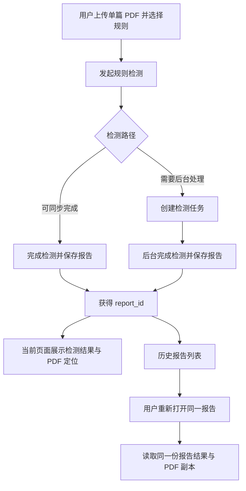
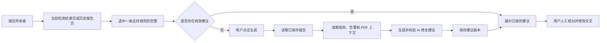

# RS-07：单篇论文检测报告接入 AI 修复建议

## 1. 变更目的

本需求是在既有“单篇 PDF 规则检测”流程上增加 AI 修复建议能力。

用户完成一篇新论文的规则检测后，应能在检测报告中选中具体告警，获取针对该告警的 AI 修复建议；用户重新打开历史报告时，仍应看到该告警已经保存且仍有效的建议。

该能力的目的不是重新判断规则检测结论，也不是自动修改论文，而是帮助用户把“检测到的问题”转化为可人工核对、人工执行的修改动作。

## 2. 现有业务基线：单篇 PDF 检测

当前系统已经支持用户上传一篇 PDF、选择规则并发起检测。检测完成后会保存一份属于该用户的报告，报告包含检测结果和受保护的 PDF 副本；用户可以立即查看结果，也可以随后在“历史报告”中重新打开。

本增量需求以已保存报告为唯一可信来源：用户不需要重新上传 PDF，也不需要重新运行规则检测。

## 3. 新增需求 RS-07

### 3.1 用户目标

用户在单篇论文的检测结果中，针对一条具体告警获得 AI 修复建议，并据此人工核对和修改论文。

### 3.2 适用范围

本期仅针对规则 11、13、14、15、16、18、22、24、28、29、31、32、33 的告警提供 AI 修复建议。

这些规则已经具备修复建议所需的规则原文映射。其他规则不属于本期范围，不应产生未经规则依据约束的 AI 建议。

### 3.3 用户流程

1. 用户上传论文并发起规则检测。
2. 检测完成后，用户在当前结果页查看告警和 PDF 定位。
3. 用户选中一条属于本期支持范围的告警。
4. 系统查询该告警是否有有效的 AI 修复建议。
5. 若已有有效建议，直接展示；若没有，用户可点击生成。
6. 系统依据已保存报告、规则、告警和 PDF 上下文生成建议。
7. 页面展示建议状态和具体修改动作，供用户人工核对。
8. 用户重新打开该历史报告时，系统仍可查询和展示已保存建议。

### 3.4 接入后的目标数据流

这里的“读取已保存报告”是本需求的重要边界：模型建议必须建立在服务端可信报告和受保护 PDF 副本之上，而不是建立在浏览器临时文本或前端提交的任意告警内容之上。

## 4. 功能要求

### FR-01：在当前检测结果页提供建议入口

当单篇论文检测完成后，当前结果页应对支持规则的告警提供 AI 修复建议入口。

- 不重新上传 PDF；
- 不重新运行规则检测；
- 仅对当前报告中真实存在的告警工作；
- 原始告警、原文定位和 AI 建议同时保留，建议不替代检测结论。

### FR-02：在历史报告页提供同等能力

用户重新打开同一份历史报告后，应能看到与当前结果页一致的建议状态与建议内容。

- 已保存且有效的建议应直接显示；
- 未生成建议的告警应允许用户生成；
- 历史报告不是静态导出物，应继续支持建议查询和生成。

### FR-03：建议的依据与输出

系统生成建议时，应使用：

- 报告中已有的规则与告警；
- 告警的定位和已有锚点；
- 对应 PDF 位置附近可取得的文本上下文。

建议输出应包含状态和具体修改动作。建议只能作为人工修改参考，不能自动修改论文或自动改写检测结论。

### FR-04：建议状态的用户含义

| 状态 | 用户可见含义 |
| --- | --- |
| 可执行建议 | 现有证据足以给出可供人工执行的修改建议。 |
| 需要补充上下文 | 当前证据不足，建议应告诉用户还需要核对什么。 |
| 证据与告警存在冲突 | 当前证据不支持该告警；用户暂不应仅依据该告警修改论文，应人工复核规则结果。 |

### FR-05：建议保存与重新打开

建议应作为报告的附加信息保存，不覆盖原始报告、PDF、规则结果或告警。

用户重新进入同一报告时，系统应能够根据报告、规则、告警和建议版本判断已保存建议是否仍适用。

### FR-06：强制生成新版本

除读取已有建议外，用户应能明确要求“强制生成新版本”。

强制生成新版本必须再次执行建议生成，不能只是把已有缓存重新返回。新旧建议应可追溯；具体的历史版本展示方式不属于本期必须交付的用户界面。

### FR-07：报告所有者访问控制

只有报告所有者可以查询或生成该报告的 AI 修复建议。

前端传入的报告标识不能单独构成授权依据；服务端必须依据当前登录用户确认其对报告和 PDF 副本拥有访问权限。

## 5. 验收标准

RS-07 完成后，应至少满足：

1. 用户完成单篇 PDF 检测后，无需重新上传或重新检测，即可对支持规则的告警生成建议；
2. 用户从历史报告重新打开同一报告时，能够看到相同告警的已保存建议；
3. 生成建议不会修改该报告的告警、规则结论、PDF 或原始检测结果；
4. 非报告所有者无法读取或生成该报告的建议；
5. 三种建议状态均有明确且不同的用户文案；
6. “强制生成新版本”实际触发一次新的建议生成，而非命中旧缓存；
7. 不支持的规则不生成 AI 修复建议；
8. PDF 上下文不可用、模型失败或建议格式不合法时，原报告仍可正常查看，且用户能获得明确失败信息。

## 6. 非目标

本增量不包括：

- 重做规则检测器、规则算法或检测报告结构；
- 重新上传 PDF 或重新执行检测；
- 为未映射规则生成建议；
- 自动修改 PDF、论文源文件或检测结论；
- 主管、学院管理员或学校管理员查看其他用户的单篇报告建议；
- 将单篇报告建议与归档论文建议合并为同一个用户入口；
- 设计完整的建议历史版本浏览页面。

## 7. 已确认的实现约束

以下内容服务于上述需求，但不是用户界面的主要目标：

- 本期仅支持十三条已有规则原文映射的规则；
- 建议生成不增加单独的用户确认步骤；
- “强制生成新版本”需要与普通缓存读取区分；
- 报告建议只面向报告所有者；
- 建议从服务端保存的报告和 PDF 副本获取依据；
- 既有归档论文建议功能应保持可用，不因 RS-07 改变其数据来源或访问范围。

## 8. 待后续确认的产品事项

- 不支持规则在告警卡中是隐藏建议入口，还是显示“暂不支持”；
- 强制生成后是否需要在界面提供旧版本查看；
- “需要补充上下文”的具体用户操作文案；
- 建议文本的人工质量验收标准，包括抽样比例、复核责任人与通过阈值；
- 模型使用必要 PDF 局部文本时的隐私告知位置和措辞。

## 2026-10-20 上线配置与约束

- 单篇当前结果、历史报告和归档结果提供修复建议；支持规则 11、13、14、15、16、18、22、24、28、29、31、32、33，其他规则隐藏入口并由 API 拒绝。
- 默认通过 `scripts/repair_model_proposal.py` 复用 `PAPER_COMPILER_CONFIG` 只读凭据及既有 `MaasClient`；不要求向网站进程另外复制原始 MAAS 密钥。Python 解释器优先使用 `REPAIR_MODEL_PYTHON`，其次 `SIX_RULE_PYTHON`。
- 所有真实请求复用 `/data/runtime/paper-compiler/budget.sqlite3`：累计上限沿用 500 元，与现有 website 阶段共享 10 元子额度。先预留后调用，单次输出最多 1024 tokens，最多尝试一次；失败或超时保留不确定占用，不重置历史费用。
- 查询已有建议不收费；缓存绑定当前规则、文档及告警身份和模型、提示词版本。用户要求生成新版本时使用独立生成标识，避免返回旧的模型缓存。
- 修复建议只供用户核对和人工修改，不改写 PDF、原始报告、检测结论或已完成归档任务。

### 规则 31—33 修复建议扩展（2026-10-20）

单篇当前结果、历史报告及归档结果均支持规则 31—33。引用规则请求保留告警中的原文、外部内容证据及规范摘要，并按模型输入上限汇总规范证据；规则/证据/程序版本变化会使缓存失效。31 仅建议修正已证实的格式问题；32 区分检索缺失与文献不存在；33 区分引用语境和文献内容，缺内容证据时不编造支持关系。费用仍由原有共享账本及 website 子额度控制。
