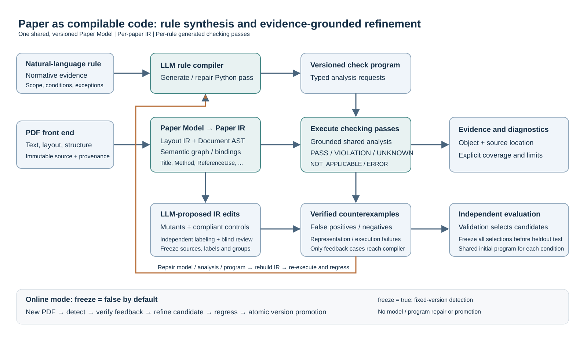
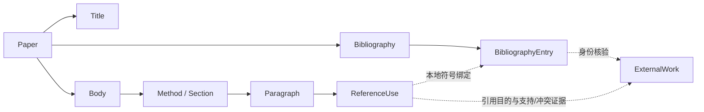

# 论文编译与自迭代框架：方法与流程


规则真值依据与实验样本的构造准入条件必须分开。带 `purpose=mutation_admission` 的材料仍作为构造数据保留，但不传入检测程序规划、生成、初稿重建或修订的规范输入。独立标注先按纯规则判断原稿合规与变体状态，再只应用对应状态的准入条件；合规对照不会因不满足“违规身份构造”条件而被排除。修订反馈仅传已核验标签、真实来源引句与实际修改，完整构造策略及混合理由保存在密封审计产物，不进入编译器。该约束按材料用途通用实现，与规则编号无关。

日期：2026-10-19。本文描述可执行框架与实验协议；具体效果以原始实验产物为准。默认在线 `freeze=false`。研究代码、首次发布与运行时版本晋级分别记录。



## 研究对象

将论文看作有结构、有引用绑定、需要语义检查的程序。PDF 是源文件，Paper IR 是编译器处理的表示，自然语言规范编译成检查 pass。检测程序和变异器操作 IR，原 PDF 保持不变。

Paper Model 是共享且有版本的类型、关系及分析接口；它不是某一篇论文的数据，也不等同于调用的大语言模型。每篇论文拥有自己的 IR，每条规则拥有由 API 生成的检查程序。新增规则的正常入口是规则文本与规范依据，框架不要求开发者增加按规则编号分支的检测代码或变异配方。

| 层次 | 表示 | 检查中的作用 |
| --- | --- | --- |
| Layout IR | 页面、原文片段、坐标及来源哈希 | 让结论能回到 PDF；区分原文和构造内容 |
| Document AST | 类型化节点、单父结构树、属性与缺失状态 | 为格式、层级及局部内容检查提供稳定接口 |
| Semantic Graph | 符号表、引用绑定、外部作品、引用用途及证据 | 为文献身份与具体引用用途检查提供可追踪事实 |

示意结构如下。Method 是有来源分类能力的 Section 子类型；不要求固定标题，也不要求每篇论文单列方法章。正式研究使用同一份共享模型定义，模型扩展的实际发生次数另行报告。



引用类似 function call：ReferenceUse 是调用位置，BibliographyEntry 是本地声明，ExternalWork 是外部资源身份。绑定成功只说明找到了对应条目，不自动说明作品存在、内容支持当前说法或格式正确。三类义务分别检查，证据不足保留 UNKNOWN。

## 统一的编译、变异与反例修订

规则输入为自然语言、适用范围、例外及可核验规范。API 生成 `detect(payload)`，通过共享查询接口读取 IR 和匹配版本的分析事实，返回对象级诊断。程序在有资源上限的隔离执行器运行，不能自行读 PDF、文件、网络或评测答案。

若现有表示不足，生成器可提出版本化类型扩展或通用来源分析请求。新增类型必须能从来源实例化；新增事实必须通过来源引句及类型检查，不能仅增加一个字段名或填入模型自称的答案。共同模型变化后重新构建受影响 IR，并检查其他规则的已验证反馈案例是否退化。

变异生成也由 API 驱动。框架把编辑提案应用到 IR 的来源文本或合法结构，检查前置条件、记录父子哈希与位置，并清除过期绑定和分析。合规、等价对照必须是实际不同且仍合规的编辑；复制原文、直接改检测结果或改派生存在性字段都不能充数。

生成器的标签只是待验证声明。另行的标注与盲复核分别判断原始局部是否合规、编辑后是否产生目标缺陷，精确核验来源引句；不一致、证据不足和结构非法的候选保留原因但排除计数。正常检测输入不包含标签、目标或 oracle。

```text
输入：自然语言规则 r，规范 B，共享模型 M，PDF 来源 S
构造：S → IR；API 生成合法编辑提案 → IR mutants 与合规对照
验证：独立标注 + 另行复核 → 按母本划分反馈、验证、独立测试并冻结
初稿：API(r, B, M) → 检测程序 P0
循环：执行反馈集 → 核验误报/漏报/UNKNOWN/ERROR
      → API(r, B, 当前模型/程序, 仅反馈集失败与证据)
      → 候选模型/程序 → 重建 IR、重执行与跨规则回归
选择：仅用验证集的标量指标选择已执行且兼容的候选
测试：所有任务及两实验条件完成选择并冻结后，统一评价独立测试
```

每规则最多五个候选轮次，包括初稿第 0 轮及最多四次修订。生成失败也占一轮。仅在反馈集无已验证错误且无 UNKNOWN/ERROR 时提前停止；未收敛、退化、预算停止和语法失败都如实记录。

诊断保留 PASS、VIOLATION、UNKNOWN、NOT_APPLICABLE、ERROR，包含规则、目标、依据、来源和定位。UNKNOWN/ERROR 不算检出或正确。所谓“论文可编译”在这里指一组结构与语义检查的诊断结果，不是对论文正确性或现实文献全集作形式化证明。

## 实验与结论边界

本轮只实验 R31—R33。每规则目标是 100 个有效违规 mutant，三规则共 300 个；每规则另建至少 30 个合规对照。按共享母本约 60/20/20 分为反馈、验证、独立测试；同一原始来源的变体不跨集合。若未完成，报告缺额，不能改变分母。

R31 依据用户提供的 GB/T 7714—2025 检查正文引用与文末著录，保留条件必需、体例及 DOI 例外。R32 的不存在负例来自全集已知的固定受控库，结论限于该库；真实开放检索另行统计，未找到不等于不存在。R33 优先使用真实引用语境，不足时采用真实文献支持的构造语境，两类分别报告；不同主题、摘要未提到及全文不可达不直接推出违规。

对比条件使用相同初稿、数据划分和证据环境：

- 一次生成：新 Python 路径第 0 轮。
- program_only：固定共享模型及分析契约，只允许修订检测程序。
- joint：允许根据可靠反馈修订程序及必要的模型、解析分析能力。

全部正式测试在选择冻结后运行。报告严格平衡正确率、检出率、误报率、UNKNOWN/ERROR、对象定位、有效样本与母本数，以及逐轮版本、耗时和费用。正式样本、来源、标签及分组不能随程序修订重新生成。

自动标注与复核均属于模型辅助标签；分开的调用不能消除同模型相关偏差。受控库的结果不能外推为开放世界不存在判断；构造语境不能冒充原 PDF 原句。三条规则实验仅验证统一框架的三类任务，不能据此声称已在 30/300 条规则上实证规模扩展。

生成、反馈、自我修订已有相关研究，因此本项目需要验证的是“统一论文结构/语义表示、来源约束 IR 反例和模型/程序共同修订”这一组合的实际作用。[Self-Refine](https://arxiv.org/abs/2303.17651)讨论迭代反馈修订；[Reflexion](https://arxiv.org/abs/2303.11366)讨论用语言反馈改善后续尝试。这些先例本身不证明本框架的新颖性或效果。

## 上线后的同一框架

每次输入 PDF，系统使用完整版本快照解析和检测。不冻结时通过独立证据审查及必要的局部验证寻找可靠反馈，形成候选修订，重建 IR、复检与跨规则回归；通过自动晋级门后原子启用兼容版本。本次复检和后续输入可复用新版。没有可靠问题时正常返回，不强制修改代码。

`freeze=false` 为默认状态。`freeze=true` 时停止系统修订与候选晋级，但仍能解析新 PDF、检索证据并按固定程序调用必要语义 API。冻结切换后禁止在途候选晋级；启用前再次核对开关及父版本。历史报告绑定实际执行版本，当前活动版本另列，避免并发升级时混淆。

原 PDF 不随迭代改变。模型与程序在候选版本包中修订；正常运行不直接任意写生产代码。保留失败、兼容版本、缓存指纹和回滚。所有模型费用共用原累计 200 元账本，包含历史支出；预算不足即停止收费并呈现实际未完成状态。

首次网站发布仍须交付原始结果并按用户确定的上线要求执行。运行时自动版本晋级在首次发布约定的门控下工作，不需要人工逐次编写修补程序。

## 评价协议补充：失败与执行边界

所有任务及两修订条件先冻结选择结果；结果可以是已执行且兼容的程序，也可以是固定轮次耗尽、始终无可执行候选的明确失败。失败保留逐轮编译记录，测试逐例记ERROR且注明execution_performed=false，不伪造程序或把它算作实际检测。预算停止和中断仍属未完成。初稿R33存在保留名称的分析契约冲突，program_only固定该契约；若共同修订仅修复此冲突，其收益不能被归因于更丰富语义表示的价值。

正式评测前记录v6执行协议，统一批量设置和独立原文验证；批次上下文变化可能改变模型回答，不假定与旧小批答复等价。执行优化不作为方法新颖性或效果证据。具体批量、缓存和资源记录放[结果报告协议](results-protocol.md)，效果以真实原始记录为准。

R33 标签可以依据已核验正文；检测器仅使用公开检索及同一冻结快照中可达的内容，不读取 oracle 正文库。标签证据与检测时内容可用性分别报告，检索或正文不足保留 UNKNOWN。
