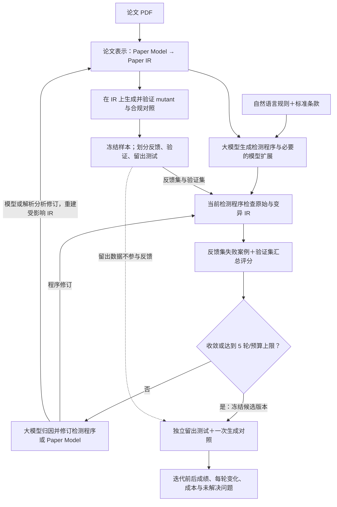

# 基于变异反馈的论文规则程序自迭代框架

日期：2026-10-18。状态：架构草案，实验定义已补充确认；研究 loop 尚未重新实现，新实验未启动。OpenAlex 鉴权已单独接入并验证。

本设计取代 v0.4 中“本阶段不实现检测系统自修复”和“每条 100 篇不同母本”的安排。目标是研究一个统一框架：输入自然语言规则，自动生成检查论文中间表示的程序，通过变异实验发现失败，再将反馈送回大模型修订程序以及必要的论文模型。R31—R33 是同一框架的三个实验任务。

## 1 已确认的范围

- 本轮只做 R31 引用格式、R32 文献存在性、R33 具体引用用途的相关性；暂不增加其他规则。
- 允许大模型自动修改检测代码，以及确有必要的 Paper Model、IR 解析与分析能力。
- 每条 100 个有效违规 mutant，共 300 个；允许同一母本产生多个不同变体。合规和等价对照另计，不能抵充违规 mutant。
- 每条的 100 个是总样本量，约 60 个用于反馈、20 个用于验证、20 个用于独立测试；不是额外要求 100 个留出测试样本。同一母本的变体归入同一集合。
- 每条最多 5 轮生成与评估：初始程序为第 0 轮，最多 4 次修订。提前收敛可停止，未收敛也保留实际成绩及剩余错误。
- R32 接受答案确定的模拟文献环境，真实开放文献检索另外运行、分别报告。受控库内不存在不得表述为已经证明现实世界不存在。
- R33 优先使用真实论文原有引用句；不足时，允许系统根据真实被引文献内容构造有依据的测试引用句，再生成违规变体。真实语境与构造语境分别统计，构造内容不冒充归档论文原文。
- 继续共用原有 1000 元累计预算和账本。此前已支出计入总额，不重复申请已经确认的预算。
- 本轮先完成研究框架与实验，不增加网站功能或生产发布。原始结果保留，受保护 CSV 不修改。
- OpenAlex 私有鉴权已接入开发检索器，DOI 精确查询已验证；题名查询的召回局限已记录，后续实现时处理。私有 Key 不进入代码、报告或版本库。

## 2 现有实现为什么没有形成目标闭环

这是依据现有代码和历史设计核对得到的实现差距，不是对新实验结果的预测。

1. 旧设计把检测系统自修复整个移出了范围，导致“误报、漏报驱动迭代”也被移除。见旧主设计第 28 行、第 128—137 行及旧交接文档第 33—38 行。应将研究用的程序合成闭环与生产系统自动更新区分开；本次恢复前者。
2. compiler.py 第 193—253 行确实调用模型生成规则，并会把编译/控制样例失败反馈给模型，但它没有接收正式变异实验产生的误报、漏报。局部编译重试不能替代完整研究闭环。
3. experiment.py 第 159—171 行执行检测与计分，第 178—213 行逐条处理三条规则，第 223—237 行汇总并按母本数结束；计分结果没有返回生成器。
4. compiler.py 第 210—215 行的能力生成依赖外部预先提供 capability_requests；普通 CLI 编译路径第 54—67 行没有自动构造并接入这些需求及验证。因此初次扩展能力尚未构成完整自动过程。
5. compiler.py 第 194 行的大型提示词包含不断补入的引用格式专用细节；analysis.py 第 147—167 行提供预写的相关性判断，validation.py 和 experiment.py 含规则编号分支。已有真实生成能力，但扩展和修复仍依赖开发者介入。

上述代码路径均相对于服务器主仓库的 backend/；旧设计本机路径为 docs/superpowers/specs/2026-10-18-paper-model-design.md，旧交接为 docs/规则编译开发交接_20261018.md。

## 3 方法与新流程

将框架收敛为四个研究模块，不把缓存、部署、队列等工程设施作为方法贡献。

| 模块 | 输入 | 输出 | 核心作用 |
| --- | --- | --- | --- |
| 论文表示 | PDF 的原文、版面和来源证据；当前 Paper Model | Paper IR 与所需分析 | 提供共享、可定位、可变异的程序输入 |
| 规则程序生成 | 自然语言规则、标准条款、IR 接口、已有共享能力 | 检测程序与必要的模型/分析扩展 | 通过大模型合成可执行程序 |
| 变异反馈 | 原始/变异 IR、独立预期、当前程序预测 | 误报、漏报及其他失败案例 | 将可核验差异转成具体反例 |
| 程序与模型修订 | 原规则、当前版本、失败证据、历史反馈 | 新程序及有依据的模型补丁 | 自动归因、修订、重新构建与回归 |

程序及模型状态记为 S_t = (M_t, A_t, D_t)，分别表示论文模型、解析分析能力和检测程序。每轮用已知预期的反馈数据计算失败集合 F_t，再执行 S_(t+1) = Refine(rule, S_t, F_t, history)。模型和分析变化后，重新从原始来源或合法变异内容构建受影响表示；保持预期与证据不变。

上述图中的样本生成与划分在主实验开始前完成并冻结，反馈回路返回论文表示时只重建表示，不重新生成或划分 benchmark。实现中必须将这两条操作分开。

生成与修订代码均由配置好的华为云 API 完成。模型权重不更新；迭代对象是程序、模型定义和解析分析能力。普通编译、执行、变异应用与统计由程序完成。

### 程序生成路线

推荐路线为直接生成读取 IR 的 Python 检测程序和可审计的模型补丁，统一通过受限执行接口运行。结构化规则解释可作为可读的生成计划保留，但不再要求所有检测逻辑只能拼现有 Rule IR 的有限算子。

另一条可行路线是保留 Rule IR，并自动扩展算子和分析能力；它具有较强的类型约束，但本次需要额外建设自动扩算子机制。当前选择直接程序合成，集中验证“反馈能否改进程序及表示”。

通用执行器、反馈器、修订器不得根据 31/32/33 选择手写检测实现。三条规则的差异放在自然语言任务、标准资料和数据中。原有 PDF 来源映射、引用绑定、公开证据网关、费用控制与隔离执行可作为共享基础复用。

## 4 反馈与自迭代的语义

每条反馈至少包含：原规则与标准依据、目标局部原始/变异内容、实际输出、独立预期、对应来源证据、失败类别、当前代码/模型版本。修订器可以读取反馈集的预期和案例；正常检测程序不得读取任何预期、变异目标或测试答案。

- 漏报：有确定违规预期，但没有检出目标违规。UNKNOWN 和 ERROR 不能被记成检出。
- 误报：有确定合规预期，程序却报告违规。
- 未知：单列证据/表示不足，不能直接说成已证明的误报或漏报，也不能当作通过。
- 执行错误：单列编译、运行或接口失败。

修订器先区分规则程序问题、表示缺失、抽取/绑定错误、事实证据不足。前面三类允许生成有针对性的补丁；证据不足可以通过已有来源补查，不能靠修改事实或标签消除失败。

模型补丁以带版本的声明和生成代码保存，经检查后加载，不能直接任意改写生产仓库。表示重建必须保留原文来源，禁止通过改动论文原文、预期标签或评价脚本来提高成绩。内部程序变了却没有重新执行的版本不得记为已验证版本。

每轮重新运行反馈集及既有回归对照。验证集用于按预先确定的指标选择候选，不向修订器提供逐例答案或失败内容；最终测试集不参与任何修订或选择。达到轮数或预算上限时输出已验证的最佳候选与完整失败记录，不强行制造收敛。

## 5 实验设计

### 数据与计数

每条规则先冻结 100 个经过验证的违规 mutant，合计 300 个；另为每条准备至少 30 个合规/等价对照。用户已确认 100 个是总样本量，按母本分组，目标为约 60 个反馈、20 个验证、20 个独立测试；分组导致的数量偏差须完整披露，不通过跨集合复用母本来凑比例。同一母本及其全部变体不得跨集合，避免对同一原文的记忆混入留出测试。

100 是每条规则的总 mutant 数，涵盖这三个集合，不意味着 100 个全部都是最终留出测试；最终结果必须标明各自分母。样本数不足时先继续构造不同位置和不同变异类型的有效变体，不能复制同一个内容、将合规对照、未验证负例或执行错误充数。

R31 的违规预期来自适用标准条款与明确的格式变异；R33 的预期来自具体引用用途及可定位的被引内容证据，不能仅以主题差异、摘要没提到或模型自评作为确定负例。独立提示与同一模型族不等于独立人工金标准，应记录模型参与验证的范围。

R33 优先从真实论文原有的引用语境派生 mutant。如果可靠负例不足，系统可以根据真实文献内容自动构造有明确支持证据的合规引用句，再替换引用或改变语境以形成违规 mutant。每个样本记录语境来源为真实原句或系统构造、构造记录、原文证据及验证结果。真实语境和构造语境分别报告样本数、检出率与误报率；构造语境不得标注为原 PDF 中实际存在的句子，也不提供虚假的 PDF 定位。同一构造母本及其变体遵守相同的集合隔离要求。

### R32 的两个实验环境

受控环境提供完整、固定的文献全集，存在性结论限定于这一明确范围。100 个违规 mutant 在此环境构造并验证；正常检测输入提供合法的库访问接口，而非答案或 mutant 标记。至少覆盖题名/作者形式变化、标识符与作品身份联合核对等情形，不把匹配器只记住编号当成完整语义核验。

开放环境继续核验真实论文中的外部作品，记录身份确认、明确冲突、UNKNOWN、检索覆盖与成本。公开检索未命中不能证明现实世界不存在；开放实验不得与受控负例合并计算“现实世界不存在检测准确率”。

### 比较与结果

主对照为同一新框架的初始一次生成程序与完整反馈闭环；第 0 轮即为 baseline，不用人工修好的旧规则包替代。关键消融为固定 Paper Model、仅迭代检测程序，与允许必要模型/分析修订的完整闭环。各条件保持相同数据划分、证据环境与最多 5 轮的上限，单独报告调用量，不能声称一次生成与多轮迭代的计算预算相同。

最终候选按验证集选择；所有轮次结束后才运行留出测试。可以在结束后统一重放已保存的各轮版本绘制测试曲线，但不得据此再选择或修订版本。

输出按规则和变异类型列出：违规检出率、合规误报率、UNKNOWN/ERROR、严格正确率、定位正确率、有效样本与母本数；同时给出版本、反例、补丁、每轮成本与耗时。用于选择的严格平衡正确率对违规和合规分别计算正确比例，UNKNOWN/ERROR 均不给正确分，防止靠弃答提高选择分数。

只有三条规则的实验不能证明已经在 30 或 300 条规则上验证 scale；本轮证明范围是统一框架在三类引用规则上的自动生成与反馈迭代，并报告新增任务所需的人工专用实现是否为零。

## 6 与已有研究的关系

Self-Refine 已研究“生成—反馈—修订”，Reflexion 已研究基于任务反馈的语言反思，CEGIS 提供候选生成与反例验证的经典思路。因此不能将“接一个大模型反馈循环”本身直接宣称为新颖贡献。

本项目要验证的具体研究主张是：统一论文表示上的规则程序合成、来源约束的变异反例反馈，以及检测程序与论文表示的协同修订。它们是否有效由主实验和消融支持，不预先宣称效果或发表保证；本框架的经验验证也不等同于形式化正确性证明。

- [Self-Refine](https://arxiv.org/abs/2303.17651)
- [Reflexion](https://arxiv.org/abs/2303.11366)
- [Solar-Lezama dissertation, Program Synthesis by Sketching](https://people.csail.mit.edu/asolar/papers/thesis.pdf)

## 7 实施与交付边界

设计审阅后形成文件级实施计划，再实现统一入口、生成与修订、数据构造和实验驱动。首先用可控失败验证“失败反馈确实触发 API → 生成了不同版本 → 重新执行”，之后运行三条规则的真实 API 实验。不得用预写补丁或固定输出演示自迭代。

保留旧 round-001、旧规则包及全部原始分数。新架构、新数据与新实验使用新目录及版本，不将旧协议结果拼入新统计。原有运行代码中的通用基础可以复用，专用分支需从新研究框架的执行路径中移出。

开发仍在 /data/projects/smart-degree-review-system 的现有分支进行，不新建 worktree。依赖与输出放 /data。生成实验程序在隔离环境运行；不修改生产数据、同学工作区、受保护 CSV 或生产服务。

本机受保护文件：C:/Users/Adminitrator/Desktop/SJTU_Project/30条规则_变异检测结果.csv。服务器对应文件为 /data/30条规则_变异检测结果.csv。

最终交付包括清晰的方法流程图、可复用框架代码、三条任务配置、冻结数据划分、逐轮生成程序与补丁、反馈轨迹、对照/消融结果及可复现实验入口。真实结果优先于预期成绩；研究闭环验证与生产启用分别决策。
