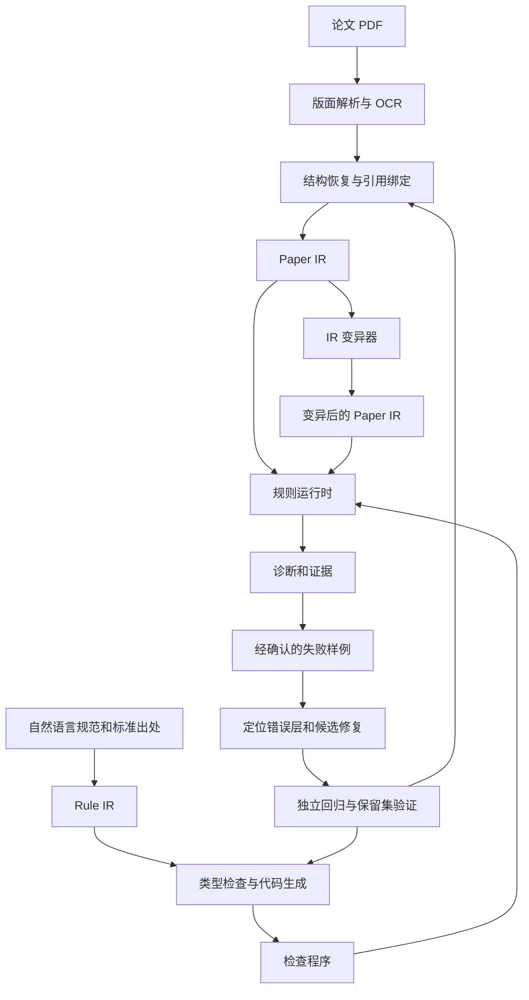

> 历史草案：已被 [v0.4 主设计](2026-10-18-paper-model-design.md) 替代。涉及人工反馈、旧阶段顺序及自动修复等内容不再作为本阶段要求；两类自动修复均延期，请以主设计及 31—33 阶段设计为准。

# 基于学位论文规范的 Paper Model 与规则编译设计草案

日期：2026 年 10 月 18 日。状态：待审阅的架构设计；本文中的类型、DSL 和检查程序是接口示例，尚未实现运行时。

本项目要把论文表示为可分析、可变异的结构化对象，把自然语言规范编译成检查程序。PDF 是输入载体，Paper IR 是检测与变异共享的操作对象。扩展规则主要通过组合公共算子完成；遇到新的概念时，扩展模型或语义能力，再由多条规则共同复用。

## 1 目标与当前实现的关系

用户提出的目标包含四项：PDF 转成中间表示；自然语言规则生成检测代码；变异直接发生在中间表示上；根据漏报和误报自动改进 Paper Model。成功的核心证据是：新增一批规则时，复用相同的节点、关系和运行时，而无需为每条规则重新开发 PDF 检测器。

本设计采用以下术语，避免把几个不同对象都称为 model。

| 名称 | 职责 |
| --- | --- |
| Paper Model | 论文语言的元模型：节点类型、字段、关系、作用域、事实状态和模型自身的不变量 |
| Paper IR | 某篇具体论文在该模型下的实例，带版本、证据和完整性信息 |
| Rule IR | 自然语言规范的形式化表示，保留出处、强度、适用条件、例外和检查逻辑 |
| Parser 与 Binder | 从 PDF 提取事实，构建层次结构、符号表并解析引用关系 |
| Rule Compiler 与 Runtime | 对 Rule IR 做类型检查和编译，在 Paper IR 上执行检查程序 |
| Repair System | 根据经确认的失败样例定位错误层，生成补丁并进行独立回归验证 |

2026 年 10 月 18 日检查服务器六规则实现发现：`backend/pdf_rules/model.py` 定义了 `PdfLine`、`PdfPage`、`PdfDocument`、`Label`、`DocumentIndex`；索引主要组织图、表、附录及其引用。`index.py` 已有作用域和引用处理；`logical_objects.py` 已做物理片段归并；`engine.py` 仍根据规则编号选择解析路径与检查逻辑。因此已有可复用的解析和局部结构能力，但尚不是本文定义的统一论文模型与规则编译系统。

复用 PDF 提取、OCR、MinerU 缓存和定位能力，通过适配器向 Paper IR 提供带来源的观测。规则运行时不得绕过 IR 再读取 PDF，也不得把旧检测器逐条包装成算子后宣称实现了规则编译。

## 2 标准依据与适用范围

主依据为本地 GB/T 7713.1—2025《信息与文献 编写规则 第1部分：学位论文》。官方平台显示其于 2026 年 2 月 1 日实施，替代 2006 版。[官方标准信息](https://std.samr.gov.cn/gb/search/gbDetailed?id=MrfiyWoM%2B4Q%3D&mode=p)

本地来源：[GB/T 7713.1—2025](<C:/Users/Adminitrator/Desktop/SJTU_Project/学位论文规范标准/学位论文规范标准/《学位论文编写规则》（GBT 7713-1-2025）.pdf>)、[GB/T 6447—2025](<C:/Users/Adminitrator/Desktop/SJTU_Project/学位论文规范标准/学位论文规范标准/GB／T 6447-2025 文献摘要编写规则.pdf>)。下表的 PDF 页码从文件第一页起计数，不是印刷页码。

| 标准与位置 | 核对到的要求或概念 | 对模型和编译器的影响 |
| --- | --- | --- |
| 7713.1 §3.4–3.8，PDF 第 7 页 | 摘要、摘要页、目次、索引、注释是不同概念 | 内容节点与物理页面分开；目次和索引具有独立目标关系 |
| 7713.1 §4.3，PDF 第 7 页 | 术语、符号和代号的一致性；专业术语和缩略词的首次出现解释 | TermDefinition、TermUse、SymbolDefinition、作用域和阅读顺序 |
| 7713.1 §4.5，PDF 第 7–8 页 | 量和单位的使用要求 | Quantity、Unit、量纲与单位约定；具体单位规则另绑定相应标准版本 |
| 7713.1 §5.1 与附录 A 表 A.1，PDF 第 8、15 页 | 前置、正文、参考文献、附录、索引、结尾；必备、可选、有则必备 | 结构类型与条件性规范分开，不能把全部章节一律设为必填 |
| 7713.1 §5.2.3 f)，PDF 第 9 页 | 题名与内容、题名一致性、中英文对照等 | Title、语言变体、文档元信息与研究内容关联 |
| 7713.1 §5.2.9，PDF 第 10 页 | 摘要涉及目的、方法、结果、结论；关键词、中外文摘要等 | Abstract、Keyword 与语义角色；摘要中的角色可以对应正文证据 |
| 7713.1 §5.2.11–5.2.13，PDF 第 10–11 页 | 目次、图表清单、符号术语清单 | TocEntry、ListEntry、GlossaryEntry，区别于正文实际对象 |
| 7713.1 §5.3.1，PDF 第 11 页 | 引言、主体、结论；不同学科正文组织有差异 | Section 支持嵌套；method 是可识别的语义角色，不强制每篇论文有同名章节 |
| 7713.1 §5.3.2，PDF 第 11 页 | 图的编号、图题、位置和自明性 | Figure、Caption、Panel、GraphicLabel、位置关系和语义标注 |
| 7713.1 §5.3.3，PDF 第 11 页 | 表的编号、表题、表头与续表 | 一个逻辑 Table 可关联多个物理片段；续表不是新建独立表 |
| 7713.1 §5.3.4，PDF 第 11 页 | 公式与编号、断行、行内形式 | Equation、MathExpression、SymbolUse，分开保存显示文本和数学结构 |
| 7713.1 §5.3.5–5.4，PDF 第 12 页 | 两种引文标注方法、注释、结论、引用文献与参考书目 | CitationCall、BibliographyEntry、Note、Conclusion、ReadingList；引文调用与被引条目分开 |
| 7713.1 §5.3.7，PDF 第 12 页 | 结论为总体结论；不能形成一定结论时允许必要讨论 | 规则必须保存例外；不能只因没有标题“结论”而报警 |
| 7713.1 §5.5–5.6、§6.5，PDF 第 12–13 页 | 附录、索引、章节划分 | Appendix、IndexEntry、层次编号和作用域 |
| 6447 §5、§6.2，PDF 第 8–9 页 | 摘要目的、方法、结果、结论；结构式摘要的构成与顺序 | 可复用的语义角色及角色顺序规则，不能把结构式要求套给所有摘要 |
| 6447 §7.3、§7.7–7.8，PDF 第 10 页 | 摘要概括要求；图表公式等及其编号的条件；学位论文编排另有规定 | 语义约束、适用条件、标准间依赖需要进入 Rule IR |

**强度必须保留。** 7713.1 §5.3.2 使用“图宜有图题”，§5.3.3 使用“表宜有表题”；仅据这些条款，不能把图表题缺失自动提升为所有场景的硬性编译错误。若行业细则、校规或用户评审配置提出更严格要求，必须记录对应来源和覆盖关系。

**结构表与具体条文需要联合解释。** 例如附录 A 将结论列为必备，而 §5.3.7 包含必要讨论的例外。规范化规则应明确例外如何满足要求；出现未解决的条款冲突时，输出规则编译诊断，不能悄悄选一边。

目录中共有 17 份 PDF，包含国家标准和 CY/T 行业标准。本轮重点核对主标准及摘要标准；参考文献、图表、章节编号等配套标准仍需逐条绑定出处。部分文件是扫描件，日期时间文件仅有 3 页，旧年份版本也须在建正式规则包时核对。文件存在不能视为条款已经完整取得或规则已经覆盖。

## 3 架构选择

| 方案 | 好处 | 局限 |
| --- | --- | --- |
| 只建章节和段落树 | 实现简单，结构清晰 | 难以表达跨章节引用、作用域、证据支持与多页对象 |
| 直接采用通用文档 XML | 可复用成熟结构和交换生态 | 仍需补充规则编译、变异、观测完整性和研究语义 |
| 有类型的论文树加关系图和证据层 | 同时支持结构规则、引用解析和语义扩展 | 初期须明确类型、关系和状态语义；本设计采用此方案 |

节点层可借鉴 JATS 的递归章节与类型化交叉引用。JATS 的 `xref` 能统一指向图、表、文献等带 ID 的对象，但这本身不证明语义引用正确。[JATS section](https://jats.nlm.nih.gov/publishing/tag-library/1.3/element/sec.html)、[JATS xref](https://jats.nlm.nih.gov/archiving/tag-library/1.4/element/xref.html)

不确定性记录可借鉴 TEI 对名称、位置、内容等不同标注维度的区分。本设计不要求内部采用 XML；初版采用有版本的 JSON 数据契约，提供类型化访问接口。[TEI certainty](https://tei-c.org/release/doc/tei-p5-doc/en/html/ref-certainty.html)



Paper Model 在结构恢复、Rule IR 类型检查、变异检查和运行时之间共享。修改它须提升版本并重建依赖数据，不能只改一个提示词而继续混用旧 IR。

## 4 Paper Model 的数据契约

### 4.1 结构树与语义角色

以下为示意结构，不是要求每篇论文具备所有这些节点。实际是否必需由规范配置决定。

```text
Paper
├── FrontMatter
│   ├── TitlePage → Title、Person、Affiliation、Degree、Date
│   ├── Declaration
│   ├── Abstract → Paragraph → Sentence → SemanticSpan
│   ├── KeywordList → Keyword
│   └── TableOfContents → TocEntry
├── Body
│   └── Section → Heading、Section、Paragraph、Figure、Table、Equation
│       ├── Paragraph → Sentence → CitationCall、CrossReference、TermUse
│       ├── Figure → Caption、Panel、GraphicLabel
│       ├── Table → Caption、Row、Cell、TableHeader、TableNote
│       └── Equation → MathExpression → SymbolUse
├── Bibliography → BibliographyEntry
├── Appendix → Section、Paragraph、Figure、Table、Equation、ReadingList
├── Index → IndexEntry
└── BackMatter
```

`Section` 和更细的 `SemanticSpan` 可具有 introduction、literature_review、method、result、discussion、conclusion 等角色。一个章节可承担多个角色，方法也可能分散在多个章节。角色用证据支持，不能仅按标题词命中确定。

结构节点具有唯一的包含父节点。语义实体如 ResearchObjective、Method、Claim、Evidence、Dataset、Experiment、TermDefinition、SymbolDefinition、Quantity 和 Unit 放入关系图，可锚定多个原文片段，避免强行塞进一棵树而丢失多对多关系。

### 4.2 文档与节点公共字段

| 对象或字段 | 契约 |
| --- | --- |
| document_id、source_digest | 区分论文身份与原 PDF 内容；不使用学生姓名作为唯一主键 |
| schema_version、parser_version、resolver_version | 固定表示方式、解析和链接版本 |
| node.id、kind、parent_id、order | ID 在同一 IR 修订链中稳定；编号变化不改变对象身份；跨重新解析通过对齐记录关联，不保证天然稳定 |
| node.fields | 类型化业务字段；保留 raw 与 normalized 值，规范化不能覆盖原文 |
| node.roles | 带证据的角色分配；可有多候选，不强制单选 |
| source_anchors | PDF 页索引、印刷页码、坐标、原始文本范围及资源片段；允许多锚点 |
| observations | 来源、方法、版本、观测状态；模型推断和原生提取分别标记 |
| coverage | 按页面、区域和事实类别描述观测是否完整，例如正文引用扫描完整不代表公式解析完整 |
| symbols、bindings | 派生符号表与引用绑定；关联输入摘要，可重算并检测过期 |
| diagnostics | 解析层问题与规范违规分开保存 |
| revision、parent_revision、change_set | 支持可回放变异、修复和审计 |

位置坐标统一为页面显示方向归一化坐标 `[0,1]`，左上为原点，同时保留原始坐标变换与页面尺寸。`pdf_page_index` 从 0 开始，`printed_page_label` 是字符串，二者不能相互替代。文字范围使用明确版本的文本缓冲区和 Unicode 码点偏移。

### 4.3 关系和类型

| 关系 | 起点与终点 | 作用 |
| --- | --- | --- |
| contains | 结构容器 → 结构子节点 | 表达论文树 |
| caption_of | Caption → Figure 或 Table | 区分题注与对象，允许题注缺失或归属不明 |
| fragment_of | 物理片段 → 逻辑 Figure 或 Table | 跨页表、组合图与多个页面位置 |
| resolves_to | 引用项 → 目标定义 | 解析后的绑定，不能替代原始目标表达式 |
| defines、uses | 定义或使用片段 → Term、Symbol 等 | 定义与使用及作用域 |
| supports、contradicts | Evidence 或 Claim → Claim | 带证据的论证关系；矛盾须对齐实体、条件、时间和单位 |
| addresses | Claim 或 Conclusion → ResearchObjective | 结论是否回应目标 |
| applies_method、uses_data | Experiment → Method 或 Dataset | 方法、数据和实验关系 |
| derived_from | Claim、Quantity 或 Observation → 依据 | 数值、结论和提取结果追溯 |
| summarizes | Abstract 或 Conclusion → 内容节点或 Claim | 摘要和结论的内容覆盖关系 |

图表坐标轴、图例、序列、单位、表头、单元格及公式符号都应有独立类型，否则规则 17、20、21 仍会退回大段文本猜测。尚不能可靠提取的字段保留 unknown，不填造事实。

### 4.4 符号表和引用绑定

符号键至少包含 `(document_id, namespace, scope_id, normalized_label)`。namespace 区分 figure、table、equation、bibliography、appendix、section、term、math_symbol 等；重复键保留全部候选，不能用字典覆盖掉重复定义。

正文“参见图 3.2”生成 `CrossReference`；“张某（2020）”生成 `CitationCall`。一个调用可包含多个引用项，处理范围、多文献和组合引用，逐项绑定。

一个引用项保存：原始目标表达式、目标类型、搜索作用域、候选定义、解析证据及状态。状态为 resolved、missing、ambiguous、unknown。只有相关定义域已完整观测时，查不到目标才能得到 missing；漏页或 OCR 失败时为 unknown。

文献引用可以类比函数调用：BibliographyEntry 是被声明的资源，CitationCall 是使用位置，Binder 完成名字解析。但“调用能找到定义”不等于“该文献支持这句话”，后者还需要语义证据检查。公式、术语的作用域也不能完全照搬程序语言，必须允许论文习惯对应的显式配置。

### 4.5 缺失与未知

每个重要字段或关系观测使用 `present / absent / unknown / ambiguous`，并保存判定依据。空字符串、空列表、空目标 ID 不能单独代表已确认缺失。

例如 Figure 存在但题注为 unknown，是解析不足；题注为 absent 且图周围可观测区域完整，才是缺题候选。Figure 本身不能仅因发现题注才生成，否则无题图会直接消失，相关规则永远无法检出。

解析置信分数不自动成为概率，也不能替代完整性证据。模型自报 confidence=0.99 不足以证明整篇论文不存在某个目标。

### 4.6 模型有效性与论文合规分离

Paper IR 必须能合法表示不合规论文：缺题名、缺图题、悬空引用、重复编号都是可表达的论文状态。IR Schema 只检查对象类型、字段格式、包含树无环、ID 唯一和真实节点 ID 引用完整性等模型不变量。

缺失的被引目标用符号表达式和 missing 状态表示，不伪造一个不存在的 `resolves_to` 节点 ID。否则 Schema 会拒绝所有负样例，变异测试无法开展。

### 4.7 一份论文 IR 的局部实例

下面是人工构造的接口示例，展示一个方法章节中的图引用，省略其余论文节点、源文件元数据和完整观测记录。这里的内容不是从真实论文提取的实验结果。

```json
{
  "schema_version": "paper-ir-draft-1",
  "document_id": "example-paper",
  "revision": 1,
  "nodes": [
    {"id": "sec-3", "kind": "Section", "roles": ["method"], "children": ["heading-3", "p-7", "fig-32"]},
    {"id": "heading-3", "kind": "Heading", "text": "第三章 研究方法", "parent_id": "sec-3"},
    {"id": "p-7", "kind": "Paragraph", "text": "系统结构如图3.2所示。", "parent_id": "sec-3", "children": ["ref-1"]},
    {"id": "ref-1", "kind": "CrossReference", "parent_id": "p-7", "items": [
      {"id": "ref-item-1", "raw_target": "图3.2", "namespace": "figure", "normalized_label": "3.2", "scope_id": "sec-3"}
    ]},
    {"id": "fig-32", "kind": "Figure", "parent_id": "sec-3", "label": "3.2", "children": ["cap-32"]},
    {"id": "cap-32", "kind": "Caption", "parent_id": "fig-32", "text": "系统结构"}
  ],
  "relations": [
    {"kind": "caption_of", "from": "cap-32", "to": "fig-32"}
  ],
  "bindings": [
    {"reference_item_id": "ref-item-1", "state": "resolved", "target_ids": ["fig-32"]}
  ],
  "coverage": [
    {"scope_id": "sec-3", "fact_kind": "figure_inventory", "state": "complete", "basis": "synthetic_fixture"}
  ]
}
```

把 `raw_target` 从“图3.2”变为“图3.9”是内容变异。重新规范化和绑定后，目标不存在且定义域完整，产生 missing 诊断。若定义域有未读页，则产生 unknown。仅在 JSON 中把 `target_ids` 清空属于破坏派生缓存，不能当作已完成有效论文变异。

完整契约中 `children` 与 `parent_id` 二选一作为存储真值，另一项由运行时派生；此展示同时列出两者便于阅读，加载器必须检查一致性。示例没有定义完整的正式 JSON Schema，不能直接据此宣称解析器已实现。

## 5 从自然语言规则到检查代码

### 5.1 编译阶段

1. **规范提取**：记录标准号、版本、条款、原页、原文摘要、强度词、主体、适用条件和例外；区分国标要求、项目推导规则及校规扩展。
2. **语义规范化**：把自然语言编译为 Rule IR，指定选取对象、量词、谓词、参数、缺失信息处理和诊断位置。
3. **类型和能力检查**：检查字段、边、算子、作用域、标准冲突及所需语义能力；不能表达的概念输出 `unsupported_capability`，不凭空生成一个已实现的判断函数。
4. **代码生成**：由固定后端把通过验证的 Rule IR 生成为检查程序。初版可生成受限 Python AST，并输出可审阅的 Python 源码。
5. **执行**：检查程序只读取类型化 IR 接口，调用登记的算子，输出结构化诊断。无法访问任意文件、网络、shell 或导入未登记代码。
6. **追溯**：每条诊断保留标准条款、规则版本、执行路径、节点 ID、证据和源位置。

自然语言前端可以使用大模型。受控 Rule IR 和确定的代码生成器保证运行边界；大模型不直接写任意脚本并立即执行。模型不确定的条款解释进入规则编译诊断。

### 5.2 Rule IR 字段

`id`、`version`、`sources`、`origin_kind`、`modality`、`applicability`、`exceptions`、`selector`、`requires`、`assertion`、`severity_policy`、`unknown_policy`、`diagnostic_template`、`test_fixtures`。

`modality` 保存 must、should、may 及原始中文措辞。`severity_policy` 来自明确的评审配置，不能覆盖原条款信息。`requires` 声明所需的解析完整性和语义能力。

### 5.3 一个可编译的示例

以“所有被引用的文献均应列入参考文献中”为例，来源为 7713.1 §5.4。以下 DSL 是接口草案。

```yaml
id: gb7713_1_2025.cited_document_listed
version: 1
sources:
  - standard: GB/T 7713.1-2025
    clause: '5.4'
origin_kind: standard_clause
modality: must
applicability:
  document_kind: thesis
selector:
  node_type: CitationCall
  role: bibliographic_citation
  scope: thesis_content
requires:
  - capability: bibliography_inventory
    coverage: complete
  - capability: citation_items
    coverage: complete_in_selected_node
assertion:
  op: every
  collection: citation.items
  predicate:
    op: exists_definition
    reference: item
    target_type: BibliographyEntry
unknown_policy: inconclusive
diagnostic_template:
  message: 引用的文献未在参考文献中找到
  primary_location: citation_item_source
```

该规则只判断条目存在性。`exists_definition` 对一个或多个已确认存在的候选返回 true；多个候选的唯一性由另一条规则检查。若参考文献页缺失、目标表达式无法解析或类型不确定，则返回 unknown。

生成代码的概念形态为：

```python
for citation in ir.select('CitationCall', scope='thesis_content'):
    for item in citation.items:
        verdict = exists_definition(ir, item, target_type='BibliographyEntry')
        emit_constraint_result(verdict, location=item.source, rule=rule_metadata)
```

图、表、公式和附录的目标存在性可复用相同的 `exists_definition` 算子；各规则保留自己的出处、对象类型和适用范围。编号解析、OCR 和正文范围识别在 IR 构建阶段复用一次，不复制到每条规则里。

### 5.4 公共算子与语义算子

结构和关系算子首批覆盖：select、filter、exists、count、forall、unique、before、within、resolve、has_incoming_use、field_present、same_value、numeric_compare、acyclic、dimension_compatible。集合查询必须传播覆盖状态，不能将空集合一律按逻辑真处理。

语义能力单独登记：classify_role、align_claim、supports_claim、contradicts_under_same_context、addresses_objective、summarizes_content、identify_required_label。它们返回证据、适用领域和不确定性；由固定规则调用，不能作为无约束的“是否违规”通用黑箱。

规则编译也须验证含义保真：保存人工审阅的正反例、边界例、原条款与形式化解释的对应表。代码能运行只说明编译器接受，不说明自然语言已经翻译正确。

## 6 检测和变异共享同一 IR

变异输入为不可变的原 IR 快照，输出为新修订和独立变异清单。变异器不能修改正式论文、原始 PDF 或当前检测结果表。

| 变异算子 | 变更对象 | 关键约束 |
| --- | --- | --- |
| remove_caption | 图表题注节点与归属关系 | 保留图表对象；合成的 absent 带变异来源，不伪称原 PDF 无题 |
| retarget_reference | 引用项的原始目标表达式 | 重跑 Binder；不能只改缓存的 resolves_to 边 |
| remove_definition | 文献条目、图表、公式或附录定义 | 更新树、实体库存和派生索引；保留指向它的调用表达式 |
| duplicate_label | 定义的编号字段 | 保留两个对象 ID，观察 ambiguous，不允许覆盖其中一个 |
| remove_symbol_definition | 符号定义及其证据 | 保留使用节点，按作用域重算 |
| change_numeric_fact | 某个数值观测或 Claim | 标明对应实验、条件、单位；避免无关量之间制造假矛盾 |
| remove_semantic_label | 坐标轴、图例、表头等标签 | 先确定必要性和对象角色，不能默认所有图都需要坐标轴 |
| break_support_relation | 论断的实质依据或内容 | 修改依据内容并重算关系；只删推断边不是有效的论文内容变异 |

每个变异记录 `operator_version`、随机种子、基线修订、前置条件、差异、受影响节点、预期目标和已知伴随影响。检测器只能看到新 IR，不能读取变异清单或预期标签。

变异前后检查模型不变量及算子后置条件。预期违规由独立测试预言机验证，不能用待测规则本身给自己的变异样本贴真值。一个变异可能触发多条规则，不能默认只有一项变化结果。

变异后原 PDF 定位只代表基线位置，不代表变更内容已出现在 PDF 中。新增节点用合成锚点；删除题注可定位到其原位置或所属图，不伪造新内容的原文坐标。

可选 IR 渲染仅用于检查、展示或端到端测试，不成为核心变异链路。IR 变异集检验规则与模型逻辑，不能替代真实 PDF 到 IR 的解析评测；两种结果分别报告。

## 7 编译结果的含义

将论文视为可编译代码时，应区分三类失败：IR 构建失败、规则编译失败、论文违反约束。前两类不能记为论文违规，也不能记为通过。

单规则结果为 `satisfied / violated / inconclusive / not_applicable / unsupported`，执行状态另记 `ok / error / timeout`。建议类条款违背可产生 warning；强制条款在当前配置下违背可产生 error。

文档汇总同时返回已确认违规和未判定项：存在硬错误为 fail；没有硬错误但必要检查未完成为 incomplete；所有适用必检约束完成且无硬错误才是 pass。pass 仅指所列标准配置和已覆盖规则，不等于论文科学结论已经被证明正确。

编号目标是否存在、符号是否定义可以接近静态分析；“该文献是否支持这个论断”“方法是否充分”“论文是否创新”依赖语义证据，有些还需要外部原文。编译框架应明确这些边界。

## 8 自动修复闭环

自动化入口是经确认的失败样例或具有独立预言机的变异测试。没有人工标签、独立证据或可验证约束时，系统只能发现可疑不一致，不能知道所有漏报和误报。

| 错误类别 | 例子 | 修复目标 |
| --- | --- | --- |
| 观测错误 | OCR 漏掉参考文献编号 | Parser、提取器、观测融合策略；重建受影响 IR |
| 结构或绑定错误 | 续表被拆为两张表；附录图与正文图混用编号 | 结构恢复、Binder、作用域规则 |
| 模型表达不足 | 不能表示组合图子图、一个方法跨多章 | Paper Model 的类型和关系；版本迁移 |
| 规范解释或编译错误 | 将“宜”转成 must，未保留例外 | Rule IR 或 Compiler |
| 语义能力错误 | 同名对象在不同实验条件下被错认成矛盾 | 证据对齐与语义算子 |
| 标注或范围错误 | 把可选参考书目当作未被引用的参考文献 | 经审阅修订标注或规范配置；保留历史标签与原因 |

流程为：收集失败及证据 → 最小化复现 IR → 错误归因 → 生成候选补丁 → 运行当前反例、旧回归和独立保留集 → 比较准确率、覆盖率和代价 → 晋级或拒绝 → 保留可回滚版本。

自动修复不得通过删除难例、将 violated 改成 satisfied、扩大 unknown、改变测试集真值或按论文 ID 写特例来提升分数。评估必须同时检查误报、漏报、未判定率和覆盖率。按母本论文划分训练、开发和保留集，防止配对样本跨集合泄漏。

初期允许系统自动生成和验证候选修复；兼容补丁在事先定义的验收门槛内可自动晋级到实验版本。改变标准语义、评测真值或不兼容 Schema 的修改须进入人工审阅；正式服务发布仍沿用项目发布流程。这里的自动修复不会自动“修好”论文内容以消除本来真实存在的违规。

## 9 现有 30 条规则对模型的压力测试

此表按当前受保护 CSV 中的规则编号讨论模型覆盖需求，不修改原文和历史结果。来源分为：明确相关条款、由条款推导的项目判据、尚需补充来源。相关条款不等于已完整推出当前规则的全部判断边界。

| 编号 | 模型和公共能力 | 来源与实现边界 |
| --- | --- | --- |
| 1 | Title、ResearchObjective、Claim；主题对齐 | 7713.1 §5.2.3 f) 相关；“完全不对应”的阈值另行定义 |
| 2 | Section、SemanticSpan、ResearchObjective；内容相关性 | §5.3.1 为一般依据；无合理关联需语义判据 |
| 3 | Claim、Entity、条件、时间、单位；矛盾分析 | §4.1、§5.3.1 为一般依据；跨语境不可直接比较 |
| 4 | Quantity、TableCell、Equation、derived_from；数值复算 | §4.1 为一般依据；必须有可复算数据及误差约定 |
| 5 | TermDefinition、TermUse、MethodStep；定义解析 | §4.3 直接相关；关键步骤理解另需语义能力 |
| 6 | Abstract、Claim、summarizes；概括能力 | 6447 §7.3；项目原记录为暂停，不自动恢复或更改结果 |
| 7 | LiteratureReview、CitationCall、SynthesisClaim | 7713.1 §5.3.1 综合评述相关；不能用引用数量代替综合性 |
| 8 | Conclusion、SectionSummary、summarizes | §5.3.7 直接相关；相似措辞本身不等于机械复制 |
| 9 | ResearchObjective、Conclusion、addresses | 总体结论要求相关；具体核心目标识别与回应判据须审阅 |
| 10 | AbstractClaim、ConclusionClaim、Evidence、supports | 内容一致性与完整性相关；需要可追溯证据，不能仅靠相似度 |
| 11 | Figure、CrossReference、符号表；目标存在性 | 图与随文关系相关；目标存在性为项目形式化判据 |
| 12 | 引用上下文、Figure 或 Table、Claim；目标语义对齐 | 正确绑定不代表对象语义正确，需另外核对判据 |
| 13 | Figure、Caption、caption_of | §5.3.2 中图题是“宜”；保留强度与上位配置 |
| 14 | Table、Caption、caption_of | §5.3.3 中表题是“宜”；保留强度与上位配置 |
| 15 | Figure、CrossReference；入边和使用关系 | 不得只把显式“图 x”视为唯一使用形式；细则待配套标准确认 |
| 16 | Table、CrossReference、续表片段 | 同上；逻辑对象与物理定位分别验收 |
| 17 | Panel、Axis、Legend、Series、TableHeader；语义归属 | 自明性及图表配套标准相关；必要标签依图表类型而定 |
| 18 | Equation、CrossReference、符号表 | §5.3.4 为建模依据；编号与被引目标存在性分开 |
| 19 | 引用上下文、Equation、数学结构 | 查到编号不足以证明引用正确，需表达式和语义对齐 |
| 20 | SymbolUse、SymbolDefinition、scope | §4.3、§5.2.13 等相关；上下文定义与常用符号约定须建模 |
| 21 | Quantity、Unit、Equation；单位推断与量纲分析 | §4.5 及单位标准相关；不能要求无量纲式或纯数学式具有物理单位 |
| 22 | CitationCall、BibliographyEntry；定义存在性 | §5.4 直接相关 |
| 23 | CitationCall、Claim、文献内容证据 | 存在性与支持性分开；仅有书目信息时可为未判定 |
| 24 | Bibliography、ReadingList、CitationCall；入边 | §5.4 区别参考文献与未引用的参考书目；不能误报附录参考书目 |
| 25 | author_year 符号键与候选集合；唯一性 | §5.3.5 与 7714 相关；同年消歧细则待原文绑定 |
| 26 | PersistentIdentifier、ResourceIdentity | 标识与资源冲突判据及外部数据来源须补充，不直接标为国标逐字规则 |
| 27 | CitationCall、SourceAnchor、图可达性 | 循环及无来源锚点的定义须形式化并补充出处；不是所有引文循环都违规 |
| 28 | TocEntry、Section、PageLabel；映射一致性 | §3.6、§5.2.11 相关；“系统性”不能用单条错位代替 |
| 29 | Appendix、CrossReference、scope | §5.5 为结构依据；附录可选，有调用才检查目标 |
| 30 | Person、Affiliation、IdentityMention、ReviewProfile | 匿名评审要求来自具体校规或评审配置，不能将公开版的作者信息要求直接反转 |

## 10 第一阶段的可验收范围

第一阶段建立统一契约，并证明共享模型能同时支撑检测与变异；不预先宣称 30 条语义规则全部可靠。

交付应包括：Paper IR Schema 与类型接口；带原文和页码的标准条款注册表；PDF 到 IR 适配器；符号表与 Binder；Rule IR 与类型检查器；固定代码生成后端和运行时；IR 变异器；可回放失败样例与候选修复报告。

首批贯通六类场景：结构存在性和顺序、题注归属、引用目标存在性、引用唯一性、术语定义与使用、一个带证据的语义场景。示范必须同时包含同一类型的正例、真实缺失例和解析 unknown 例，并演示同一公共算子服务图、表、公式或文献等多种目标。

验收不能只计算变异杀伤率，还需报告：

1. PDF 到 IR 的节点、关系、作用域与源定位准确性；节点丢失造成的规则漏报单列。
2. 正确 IR 上的规则逻辑表现、错误类型区分、规则解释与标准条款的一致性。
3. IR 变异的模型有效性、变更可回放性和预期违规的独立确认。
4. 在真实 PDF 上的端到端误报、漏报、未判定和技术失败，按论文母本隔离样本。
5. 扩展性：新增规则是否只需 Rule IR；新增模型能力的数量和复用情况；每条规则的人工作业时间、LLM 调用量、审阅修改量。
6. 自动修复：至少分别演示解析错误和规则编译错误的归因及回归；模型能力扩展展示版本迁移，不混称一次提示词修改。

“30 到 300”的演示应引入保留的真实新规则和新论文，而非把同一个谓词改 300 个名字。相同算子族的规则应能批量编译；新的科学语义仍可能需要新模型能力，这是扩展成本应如实测量的部分。

## 11 大模型 API 的使用位置

模型与 IR 的设计、类型契约、引用绑定、确定性检查和 IR 变异不需要新的 API key。现有 MinerU/OCR 能力可继续作为 PDF 前端，布局解析服务凭据与通用大模型凭据分别管理。

需要在系统运行时使用大模型的环节包括：自然语言规范到 Rule IR 的翻译、研究方法和论断等语义结构提取、受约束的语义算子，以及自动修复候选的生成。是否需要视觉模型取决于图表内容是否已能由现有解析器充分表达；第一版可以先用文本模型验证规则编译。

接入前只需确定服务商、模型名、Base URL、凭据文件路径，以及可发送论文内容的范围和调用预算。密钥保存在服务器 `/data` 下的私有配置中，由环境变量或安全配置引用；不放入对话、Git、规则、IR 和日志。具体模型选择需要针对真实条款翻译、中文论文结构化和修复样例比较，不用聊天表现代替评测。

## 12 审阅重点与后续实现边界

建议审阅以下四项：Paper Model、Paper IR 与 Rule IR 的分工；树、关系和证据三者组合；确定性规则与语义能力的边界；自动修复依据及晋级条件。设计确认后再形成实施计划和具体 Schema，运行实验前固定数据划分及评测口径。

后续项目代码仍通过 `ssh sjtu-new` 在 `/data/projects/smart-degree-review-system` 的 `rules-11-20-detectors` 分支开发，复用唯一工作目录。现阶段不修改线上服务和受保护结果 CSV；新模型实验和评测另存，旧系统与历史结果保留可追溯性。
