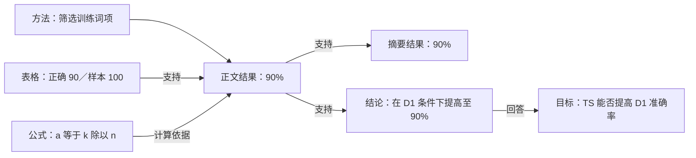

# 完整示例：一篇论文如何进入 IR 并接受规则检查

本目录保留 v0.1 的**人工编写教学样例**，用于解释通用全文结构；它不是生产系统的人工作业流程。当前阶段以 [31—33 新示例](../citation-examples/README.md) 为主。实验和文献均为合成内容；不是从真实论文 PDF 自动提取的结果，不是运行检测器得到的评测成绩。其用途是把模型、编译接口、变异和预期行为讲清楚。

## 1. 文件和读取边界

| 文件 | 内容 |
| --- | --- |
| `source-paper.txt` | 教学论文全文：题名、摘要、目录、绪论、综述、方法、实验、结论、参考文献、附录 |
| `paper.ir.json` | 67 个结构节点、来源区间、覆盖与 profile |
| `paper.analysis.json` | 手工标注的章节角色、符号表、6 个引用绑定、主张、目标和关系 |
| `rulespecs.design.json` | 11/18/22/29 共用解析模板，13 组成约束，10 语义证据追溯 |
| `rule-ir.design.json` | 4 条目标存在规则的手工编译展开示例 |
| `generated-R11.py.txt` | 规则 11 的生成代码形状；接口尚未实现，不能作为现成检测器运行 |
| `variants/*.paper.ir.json` | 8 份完整变体 IR，每份均可单独阅读 |
| `mutations.json` | 变异操作、父/子哈希、前置条件与依赖失效策略 |
| `oracle.expected.json` | 人工推导的目标预期，仅评测器读取 |
| `diagnostic.design.json` | “删除图但保留引用”的预期诊断样式 |

未来检查器只接收当前 IR 和匹配其哈希的 analysis，不读取 `oracle`、变异目标、文件名中的规则号或祖先版本的检测结果。IR revision 与 operation ID 使用不含目标规则号的标识。设计文件名便于人阅读，不是检测输入特征。

## 2. 文档树与语义图

```text
Paper
├─ FrontMatter
│  ├─ TitlePage → Title
│  ├─ Abstract → Paragraph
│  └─ ToC
├─ Body
│  ├─ Section（绪论）→ Heading、提出目标的 Paragraph
│  ├─ Section（相关研究）→ Paragraph → CitationUse [1]、[2]
│  ├─ Section（研究方法）
│  │  ├─ Paragraph → TermDefinition TS
│  │  ├─ ReferenceUse 式 (1)
│  │  ├─ Equation 1 → MathExpression a = k / n
│  │  ├─ SymbolDefinition a、k、n
│  │  └─ ReferenceUse 附录 A
│  ├─ Section（实验结果）
│  │  ├─ ReferenceUse 图 1 →（绑定）Figure 1
│  │  ├─ Figure 1 → Caption、图形内容描述
│  │  ├─ ReferenceUse 表 1 →（绑定）Table 1
│  │  ├─ Table 1 → Caption、表头与数据行 → 单元格
│  │  └─ Paragraph（准确率 90%）
│  └─ Section（结论）→ Paragraph
└─ BackMatter
   ├─ Bibliography → BibliographyEntry 1、2
   └─ Appendix A → Paragraph
```

结构节点不会把 `method` 写死在 Section 类型里。`paper.analysis.json` 给“研究方法”一节赋 method 角色，来源锚定到该节段落。对应的论证关系为：



图形在这个文本样例中用明确的文字说明代替像素，因此它不能验证真实图表识别能力。视觉解析的验收需另用真实 PDF 来源核对、可控渲染回读和独立自动验证；不能把本例当作视觉能力成绩。

## 3. 从自然语言生成检查代码

输入规则 11：“正文引用的图不存在。”

1. 对象：正文中的 ReferenceUse；目标类型：Figure。
2. 约束：每个符合范围的引用应链接到图声明。
3. 前置能力：正文引用抽取、图实体抽取、作用域解析。
4. 缺失证据：目标查找为空，且图对象清单在指定范围满足覆盖契约。
5. 降级策略：扫描或抽取不完整时 UNKNOWN；目标有歧义时不谎报“图不存在”。
6. 后端：复用 `reference_target_exists` 原语，生成独立的规则检查模块及来源映射。

改变 `expected_kind` 和 namespace，就可用同一模板描述公式引用（18）、本地参考文献引用（22）、本论文附录引用（29）。**这里展示手工设计的编译产物形状，尚未实现自然语言编译器。**

规则 10 的编译目标是另外一种能力：选择摘要/结论中的具体结果主张，检查支持边、实验条件和正文证据范围。它不能只靠把规则 11 的 Figure 改成 Claim 完成；必须先实现通用的主张和证据抽取能力，之后才能在同类语义规则间复用。

## 4. 基线与 8 个变体

基线的已标注目标包括 3、10、11、13、14、18、22、24、29，人工预期通过；这不是“整篇符合国标”。它是论文片段，不具备所有正式学位论文的前置材料，也未提供实际印刷页码。规则 32 的外部存在性没有真实来源证据，预期 UNKNOWN。

| 变体 | 修改的 IR 内容 | 预期目标行为 | 要证明的设计性质 |
| --- | --- | --- | --- |
| M11 | 删除 Figure 1 子树，保留 use-figure | R11 VIOLATION | 未声明的调用目标可检测 |
| M13 | 只删除 Caption | R13 VIOLATION；R11 PASS | 图题和图实体是不同对象 |
| M22 | 删除 BibliographyEntry 2，保留 [2] | R22 VIOLATION | 本地条目链接不依赖外部检索 |
| M03 | 正文 90% 改为 95%，表格仍是 90/100 | R03 VIOLATION；允许 R04 次生影响 | 同一上下文的数值矛盾可表达 |
| M10 | 摘要 90% 改为 95%，正文/表格仍为 90% | R10 VIOLATION；允许 R03 次生影响 | 摘要主张必须追溯到正文证据 |
| M29 | 删除 Appendix A，保留附录引用 | R29 VIOLATION | 附录与图共用目标解析能力 |
| E01 | 图定义、图题、引用文本与 selector 同步由 1 改 9 | R11/R13 PASS | 相同实体换名不应改变相关检查结果 |
| U01 | 模拟图区域未解析：图不在 IR，图/题区域覆盖 partial | R11 UNKNOWN | “没识别到”不等于“论文没有” |

E01 只证明相关的存在性/题注检查保持不变。一个单图被改为编号 9，可能触发另行启用的连续编号规则；不能把这个等价性断言扩展成“所有规则都不变”。

语义变异只更改原始 IR 中的文本，不直接改 `Claim.value` 或 `supports` 边；后续必须重建对应分析。分析文件只能配基线 IR 使用；各变体没有伪造“已由语义模型生成”的 analysis。

## 5. 来源定位与变异后的证据

基线每个节点都映射到 `source-paper.txt` 的 Unicode 字符区间，文件哈希存于 source_artifacts。真实 PDF 版前端使用页号、bbox 和坐标变换替代该文本定位。

被改写的节点标为 synthetic，记录 ancestor_spans。**原始文本仍在归档源文件中，并不表示它仍存在于 mutant 的有效文档。** 删除节点的事实记录在单独的变异事务中；mutant 的 AST 是该测试用例的有效表示，检测器不能重新打开祖先全文把已删内容补回来。

若做端到端 PDF 测试，应先从 mutant IR 渲染一个新文档，再解析新文档，产生新的 source_artifacts 和定位。不能解析未变异的原 PDF 后声称检查了 mutant。

## 6. 未来“自动修复 paper model”的教学案例（当前不实现）

按用户最新要求，本阶段不实现检测系统自修复，也不实现检测违规后的大模型修复建议。下面仅保留未来功能的概念说明，不属于本阶段开发或验收要求。

设一个真实 PDF 明明有图题，但解析器把它误分成普通段落，规则 13 报警。可验证闭环为：

| 阶段 | 输入／动作 | 产物 |
| --- | --- | --- |
| 反馈 | 在可控渲染样例中，独立来源与位置证据证明图题存在，自动识别误报 | 独立反例与原始证据 |
| 归因 | IR 图实体存在，但 caption ownership 错误 | 归因到版面→结构 pass，而非 R13 判断逻辑 |
| 候选 | 修订通用归属逻辑或抽取提示词 | 新 builder/model 版本；不制造原 PDF 中没有的图题 |
| 重建 | 同一原 PDF 重新生成 IR | 图题节点及正确来源关系 |
| 回归 | 同时测真实缺图题的 M13、共享图题、续表、正文邻近行等 | 真误报消失；真实违规仍报；UNKNOWN 不上升掩盖问题 |
| 发布 | 冻结回归、独立保留集、影子运行通过 | 可追溯候选与回滚版本 |

若原 PDF 本来就缺图题，自动“补造图题”是修改论文或掩盖错误，不是修复解析模型；不应作为上述闭环的通过方式。若缺的是 IR 本身无法表达的对象类型，才提出 schema 迁移。

## 7. 本轮实际验证范围

交付检查对 JSON 语法、树的连通性/唯一父节点、节点引用、文本区间、输入哈希、基线绑定目标类型、分析端点、变体独立性、规则原文编号以及基线数值作机械核对。`validation-report.json` 记录结果。

这些验证不包含真实 PDF 解析、不包含模型调用、不包含真实论文语义准确率、不包含自然语言自动编译性能。表中的 PASS/VIOLATION 是设计的预期，始终与实际执行结果分开保存。
